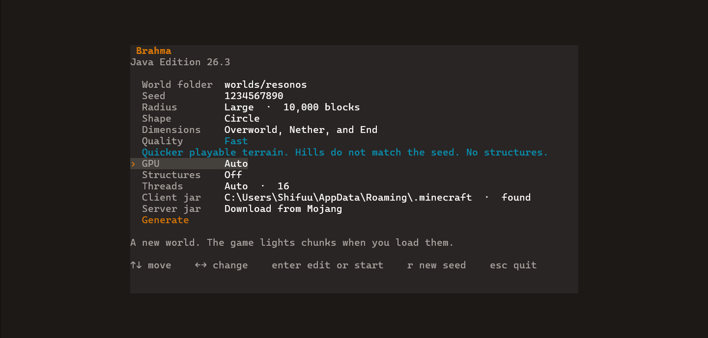

# Brahma


  
  
  
  <a href="LICENSE"></a>

Brahma is an ultra-fast Minecraft world and chunk generator, written in Rust. It pregenerates Minecraft: Java Edition 26.3 worlds in parallel, skips lighting, and can use a fast mode that drops the density math and runs on the GPU. A seed, a center, and a radius become a world folder the game opens, with the chunks already generated.



Covered:

- [x] Terrain, biomes, carvers, and decoration (ores, trees, plants)
- [x] Structures, in exact quality
- [x] The overworld, the Nether, and the End
- [x] Chunks saved at `minecraft:features`, in a world folder 26.3 opens
- [x] Resuming an interrupted run

Not covered:

- [ ] Lighting
- [ ] The last chunk statuses (`initialize_light`, `light`, `spawn`, `full`). The game finishes those the first time a chunk is loaded
- [ ] The initial mob spawn
- [ ] Flat worlds

## Build

You need Rust 1.85 or newer. [rustup](https://rustup.rs/) installs it. A JDK is only for the first generate, not for compiling.

Brahma builds on a public Horizon commit. Fast terrain and the first-run asset prepare are not in that commit yet, so the patch script downloads it and applies `patches/horizon.patch`. The result is `.horizon/`, which is not part of this repository. The script needs Git and Python 3.

```sh
python tools/patch_horizon.py
cargo build --release
```

The binary is `target/release/brahma` (`brahma.exe` on Windows).

## Generate
**Command**
```sh
brahma generate --out <world dir> --seed <i64|text>
      [--resources <dir>] [--minecraft-dir <dir>] [--server-jar <jar>]
      [--java-home <dir>] [--dimension <id>]... [--all-dimensions]
      [--preset normal|large_biomes|amplified|single_biome_surface]
      [--no-structures] [--datapacks <folder>]
      [--name <level name>] [--radius <blocks>] [--shape square|circle]
      [--center <x> <z>] [--threads <n>] [--strip-width <chunks>]
      [--compression zlib|lz4|gzip|none] [--quality exact|fast]
      [--gpu auto|on|off] [--debug]
```
**Example**
```sh
brahma generate --out ./worlds/demo --seed 12345 --radius 2500 --threads 8
```

Open the folder in Minecraft: Java Edition 26.3. The game lights the chunks on load.

`brahma` with no arguments opens a menu for the same choices. Flags, exact and fast, what changes speed, resume, and dump are in [Generation](docs/generation.md).

## Credits

- Athulsib
- World generation is [Horizon](https://github.com/horizon-rust/horizon), a clean-room Rust port. Brahma does not include Mojang's code. The first run prepares assets from the player's own Minecraft jars.
